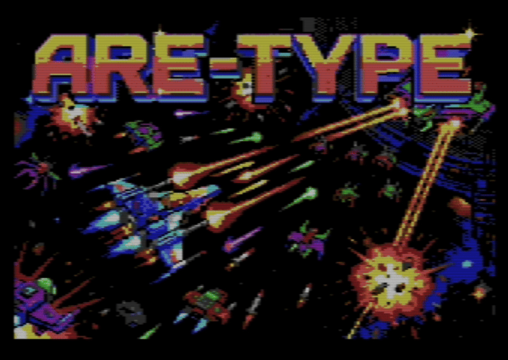
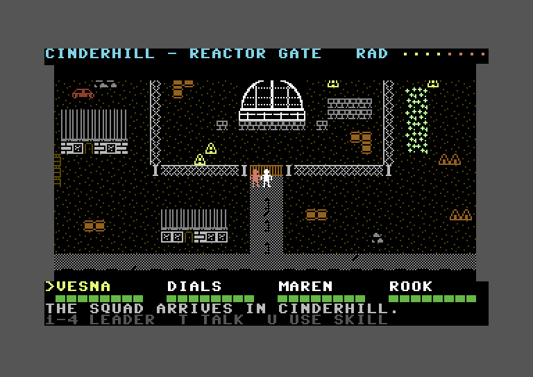

# Commodore 64 Games

Games for the **Commodore 64**, written from scratch in 6502 assembly, built with
[ACME](https://sourceforge.net/projects/acme-crossass/) and tested in the
[VICE](https://vice-emu.sourceforge.io/) `x64sc` emulator (PAL). Each game lives in its own
directory with its source, assets, and README.

## Games

### [ARE-TYPE](aretype/) — horizontal shoot-'em-up

An R-Type-style, horizontally-scrolling shoot-'em-up with a multiplexed sprite engine, a boot
splash in multicolor bitmap mode, and a SID soundtrack remixed from the medieval *Dies irae*
chant. See [`aretype/README.md`](aretype/README.md) for gameplay, build instructions, and
technical deep-dives.

### [Nuclear Land](nuclear-land/) — post-apocalyptic party RPG (work in progress)

A prototype party RPG set in a ruined town whose failing reactor holds a mystery: walk Cinderhill
with a four-person squad and talk to its wary townspeople by typing keywords, earning their trust
one conversation at a time. The smooth-scrolling town of Cinderhill and its people are in; the
talking screen comes next. See [`nuclear-land/README.md`](nuclear-land/README.md) for status, build instructions,
and how it works.

## License

See [LICENSE](LICENSE).
