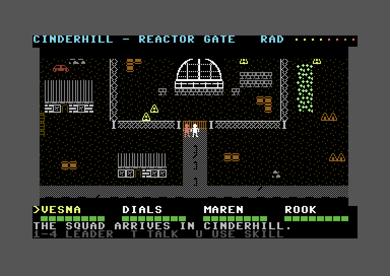

# Nuclear Land



A prototype post-apocalyptic party RPG for the **Commodore 64**, written from scratch in 6502
assembly, assembled with [ACME](https://sourceforge.net/projects/acme-crossass/) and tested in the
[VICE](https://vice-emu.sourceforge.io/) `x64sc` emulator (PAL). **Work in progress.**

## The game (planned)

Some decades after a nuclear war, the town of **Cinderhill** survives on a small pre-war reactor
that powers its lights, water pump and greenhouse. Lately the reactor has been sputtering, and
**Abel Voss**, the engineer who kept it alive, has vanished. The town has split in two: the
**Keepers** guard the reactor as sacred, while the **Dimmers** want it shut down before it kills
everyone. Rumour says outsiders sabotaged it — and your squad has just walked in.

You explore the ruined town as a four-person squad and talk to the people who live there by
typing keywords. Townspeople are wary of strangers and open up as their trust in you grows; each
conversation gives up a piece of the mystery. The squad:

| Member | Skill |
|--------|-------|
| **Vesna** | Talker |
| **"Dials" Okonkwo** | Tinker |
| **Sister Maren** | Medic |
| **Rook** | Scout |

Combat, an overworld and saving are out of scope for the prototype — the point is the town and
its people.

## Status

**Milestone 1: walking engine (done).** Smooth 8-frame glide per tile step in all four directions,
hardware fine scrolling with double-buffered coarse scrolling, a rock-still status line and squad
strip, the camera stopping at the map edges, a steady 50 fps (PAL).

**Milestone 2: Cinderhill (done).** The real town, 64×48 tiles:

- Ten districts (Market Row, the Reactor Yard and Gate, Old Lots, West Shacks, the Caravan Camp,
  Town Hall, Storehouse, Greenhouse and the Town Square), drawn from a 45-tile hi-res set with a
  multi-cell reactor dome.
- Seven townspeople as hardware sprites. They stay glued to the map while it scrolls and block your
  way. Pip wanders Market Row.
- A status line naming the district you're in, with a Geiger meter that rises near hot spots.
- A squad strip with the leader marked, health bars, and a message line.
- Keys **1–4** switch the leader, and the squad figure takes the leader's colour.
- Glowing hot spots drain everyone's health. A member at zero is sick and can't lead. With Maren
  leading, **U** treats the squad, and a sick Maren slowly recovers away from radiation. Nobody dies.

**Milestone 3: talking to Hesper (done).** Press **T** next to Hesper, the water-keeper in front of
the Market Row pump house, and the screen changes:

- Hesper's portrait sits on the left, as a full-resolution hi-res bitmap.
- On the right are the name, a trust meter and the running conversation, drawn in the C64's own
  upper/lower-case font. Your words are in yellow, the answers in grey, and long talks scroll.
- At the bottom: the Known keywords, who leads, and a prompt. Type any word and press RETURN. The
  first 4 letters are enough, so WATE finds WATER.
- Hesper starts wary and deflects some questions. Trust grows with each new topic answered, faster
  if Maren leads. If Vesna leads at the first meeting, Hesper starts one step friendlier. With
  enough trust, Hesper shares a clue.
- Words in CAPITALS in an answer join the squad's Known list.
- RETURN on an empty line takes you back to the town exactly as you left it, and Hesper remembers
  you.

The other townspeople don't talk yet; T next to them still says so.

**Next:** dialogue for the whole cast, written out for review before it goes in.

## Running it

From `nuclear-land/`:

```sh
mkdir -p build
acme -f cbm -o build/nland.prg main.asm
x64sc -pal -autostartprgmode 1 -autostart "$PWD/build/nland.prg"
```

Pass an **absolute** path to the PRG — on macOS the `x64sc` wrapper starts VICE from inside the
app bundle, so a relative path isn't found. The game is PAL-only; keep `-pal` if your VICE is
set to NTSC.

### Controls

| Key | Action |
|-----|--------|
| Cursor keys | Move up / down / left / right |
| `I` / `K` / `J` / `L` | Move up / down / left / right |
| `1` `2` `3` `4` | Choose the leader: Vesna, Dials, Maren, Rook |
| `T` | Talk to the person next to you |
| `U` | Use the leader's skill (Maren: treat the squad) |
| Letters, `DEL`, `RETURN` | While talking: type a keyword (up to 12 letters) and ask; `RETURN` on an empty line leaves |

Both sets of movement keys always work. There is no joystick support.

## Building the assets

The tile graphics and map data in `gen/` are generated and committed. To rebuild them after
editing the tile art in `tools/make_tiles.py` or a map in `maps/`:

```sh
python3 tools/make_map.py cinderhill  # also regenerates gen/tiles.bin, tilecolors.bin, tiles.inc
python3 tools/make_map.py testmap     # the engine tests' map
```

A map is 48 rows of 64 legend characters followed by meta lines (`start`, `place`, `person`,
`wander`). Ground and roads are passable: `.` ground, `=` road, `-` and `|` lane markings, `%`
cracked road, `^` hot spot. Everything else blocks: `#` brick wall, `C` concrete, `W` broken window,
`D` door, `R`/`E` tin roof and its edge, `F`/`V` chain-link fence, `+` fence post, `G` gate, `!`
hazard sign, `o` barrel, `g` greenhouse glass, `*` plants, `[` `]` wrecked car, `P` pump, `S` market
stall, `T` tent, `K` cart, `:` rubble, and `@` for the 6×4 reactor dome. The tool also writes each
map's radiation field, place table and people table, and `tests/test_map_data.py` checks the map's
rules: no hot spot ever cuts off part of the town, and everyone can be reached.

**Portraits.** Each portrait is a 128×152 PNG in the C64 palette with at most two colours in every
8×8 block, saved as `assets/<name>_c64_128x152.png`. Convert it with:

```sh
python3 tools/make_portrait.py hesper warden
```

The converter maps every pixel to the nearest C64 colour. In any block that has more than two, it
keeps the two most common, and it reports how many blocks it had to change.

**Dialogue.** Each person's conversation is a plain text file in `dialogue/`, for example
`dialogue/hesper.txt`. It sets their name, role, starting trust and favourite squad member, and
lists topics, each with a keyword, a minimum trust tier, the answer, and an optional deflection.
The format is described at the top of `tools/make_dialogue.py`. Rebuild with:

```sh
python3 tools/make_dialogue.py
```

`tests/talksim.py` holds the same conversation rules in Python, and the talking-screen tests compare
the game against it.

## Tests

The tests run the real PRG headless in VICE, then compare screenshots pixel by pixel and read
game state through VICE's binary monitor. They need Python 3 with Pillow, and they expect VICE at
`/Applications/vice-arm64-gtk3-3.10/bin/x64sc` (set `X64SC` in `tests/vice.py` otherwise).

```sh
python3 tests/run_all.py
```

Each test forces a default PAL machine and never writes to your VICE settings. Special builds
(`-DAUTOWALK=n`, `-DFIXED_FY=n`, `-DSTRESS=1`, …) script the walking, pin the scroll position or
add load so every frame of a glide can be checked.

## How it works

| File | Role |
|------|------|
| `main.asm` | Start-up, memory setup, main loop |
| `irq.asm` | Raster interrupt chain: status line, map band, HUD |
| `walk.asm` | Step glide, camera, collision, edge clamp |
| `view.asm` | Draws the map into the back screen buffer |
| `input.asm` | Keyboard matrix scan: movement and action keys |
| `people.asm` | Townspeople sprites: placement, visibility, blocking, Pip's wander |
| `status.asm` | Status line: place name and Geiger meter |
| `squad.asm` | Health, leader, actions, radiation, healing, messages |
| `hud.asm` | Squad strip: names, health bars, message line |
| `charset.asm` | Builds the character set (ROM font + tiles) |
| `talk.asm` | Talking screen: entering, the portrait, the raster split, leaving |
| `talktext.asm` | Bitmap text: the font, header, trust meter, scrolling conversation, typing |
| `talkrules.asm` | Keyword matching, trust tiers, the Known list |
| `hw.inc` | Hardware registers and memory map |

- **Memory:** VIC bank 3 — two screen buffers at `$C000` / `$C400`, the character set at
  `$C800`, the squad sprite at `$E000`. BASIC ROM is banked out so the colour buffer at `$B800`
  reads back as RAM.
- **Character set:** codes 0–63 are the C64 ROM font, copied in at start-up. Tiles start at
  `$40`, and every tile code from `$80` up is impassable, so collision is a single compare.
- **Split screen:** a three-stage raster interrupt chain runs the status line and HUD at
  40 columns with no scroll, and the map band in between at 38 columns with the frame's fine
  scroll.
- **Talking screen:** it runs its own two-interrupt raster chain. Rows 0–18 are a hi-res bitmap
  at `$E000`, with cell colours at `$C000`. Rows 19–23 are text, switched over at the end of
  raster line 202. The bitmap sits under the KERNAL ROM, where the CPU can write but can't read
  back, so the conversation is kept in RAM and redrawn when it scrolls. Leaving rebuilds the
  walking screen from the game state.
- **Vertical scrolling:** uses FLD — badlines are only ever *delayed*, never brought forward, so
  rows never get fetched twice and the HUD never slips. The map shows through a fixed window
  (raster lines 74–210), so its top and bottom edges don't bounce as it scrolls.
- **Coarse scrolling:** each step redraws the back buffer in thirds across the first frames of
  the glide, then flips buffers mid-glide. The colour RAM copy is unrolled to fit in the
  flip frame. These long jobs run after the sprites are placed, so sprite positions are always
  written well before the map is drawn.
- **Townspeople:** each person's sprite position comes from the same camera and fine-scroll values
  as the map, so they move with it pixel for pixel. A sprite is only shown while all of its raster
  lines stay clear of the screen splits, so near the top and bottom of the map people pop in and
  out instead of sliding past the edge.
